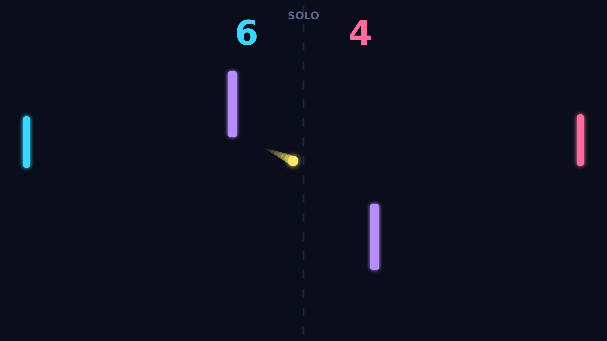
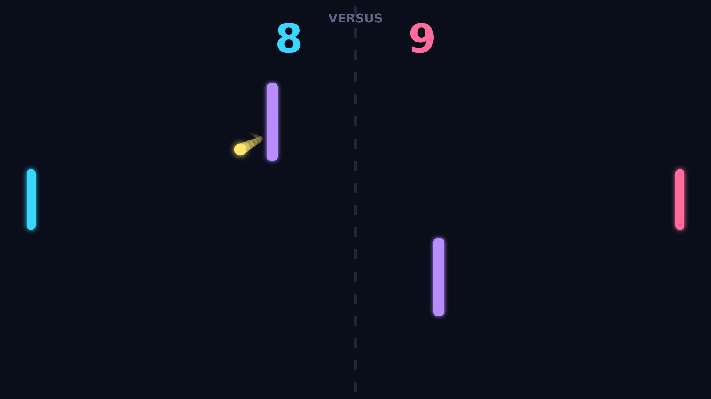
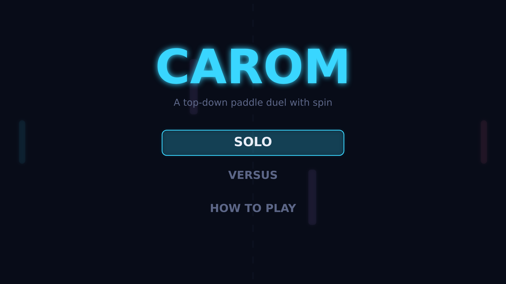

# Carom

Carom is a top-down paddle duel played on a single glowing field. Two paddles
guard the left and right edges, a pair of pillars stand in the middle of the
court, and a bright ball ricochets between them. Serve it, rally it, and bend it
past your opponent until someone reaches match point.

A point begins with a serve down the centre line and quickly turns into a
reading contest. Where you strike the ball on your paddle decides where it goes:
catch it near an edge and it leaves with spin, curving across the court instead
of flying straight. The two central pillars turn every shot into a question —
thread the gap, or play the angle and let the ball bank off a pillar into the
corner your opponent just left.

Spin is the heart of Carom. A curving flight keeps bending the whole way down the
table, so a shot aimed straight at a paddle can hook away at the last moment, and
a shot that looks like it is sailing wide can curl back in for a winner. Each
rally the ball speeds up, so the longer a point runs the sharper your reads and
reactions have to be.

Play SOLO against a positioning AI that covers its home and chases the ball, or
VERSUS a friend sharing the keyboard. First to eleven wins, but you must win by
two, so a tight match can stretch into a run of nerve-testing deciders at match
point.

